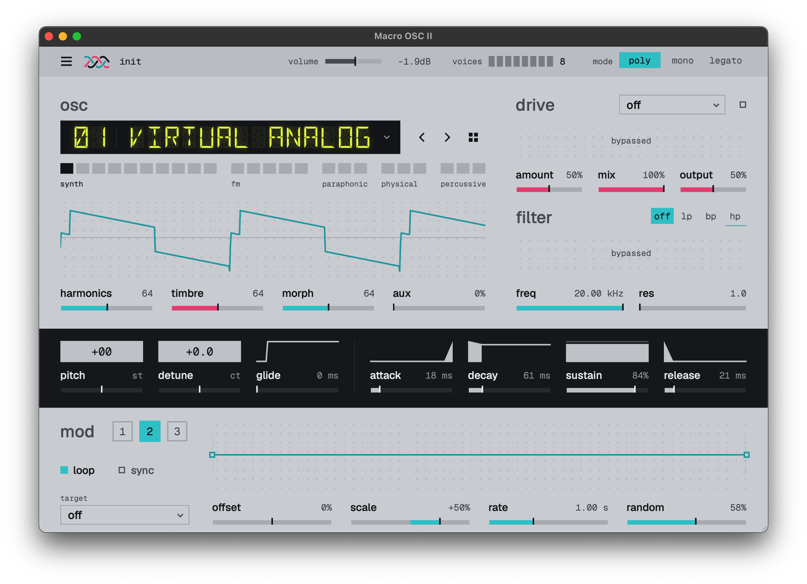

# Macro OSC II

A free, open-source polyphonic synthesizer built on the Mutable Instruments Plaits macro oscillator. VST3 plugin and standalone app.

Macro OSC II is the sibling of [Macro OSC](https://github.com/Reece4000/macro_oscillator), which is built on Mutable Instruments Braids. The two share their layout, controls, effects and modulation; Macro OSC II inverts Macro OSC's colour scheme.

[](https://github.com/Reece4000/macro_oscillator_ii/releases/latest)
[](LICENSE)



## Features

- All 24 Plaits models from firmware 1.2, with Harmonics, Timbre, Morph and an out/aux blend.
- Model selection from a menu, arrow buttons, or a map of the models grouped as synth, FM, paraphonic, physical and percussive.
- A waveform display of the selected model at its current settings.
- Poly (1–8 voices), mono and legato modes; constant-time glide; pitch, detune and an ADSR envelope.
- The key gate drives Plaits' trigger input, so struck models ring from each note and six-operator patches release with the key.
- Per-voice distortion: 19 modes, 13 of them adapted from Airwindows, with Amount, Mix and Output.
- Per-voice low-, band- and high-pass filter with a draggable response curve.
- Three MSEG modulators:
  - Drawable curves with loop and tempo sync.
  - Scale, offset, rate and random controls.
  - 14 destinations, including model, pitch, harmonics, timbre, morph, level and every filter and distortion parameter.
- Presets, output volume, a resizable interface (75–150%) and tooltips.
- Per-voice headroom, resonance gain compensation and an output limiter.

## Download

Builds for macOS on Apple Silicon are on the [releases page](https://github.com/Reece4000/macro_oscillator_ii/releases/latest).

- **VST3:** unzip `MacroOSCII-macOS-arm64-v0.1.0-vst3.zip` and copy `Macro OSC II.vst3` to `~/Library/Audio/Plug-Ins/VST3/`.
- **Standalone:** unzip `MacroOSCII-macOS-arm64-v0.1.0-standalone.zip` and open `Macro OSC II.app`. Audio and MIDI devices are set from the ☰ menu.

The builds are ad-hoc signed, so macOS may block them on first launch. Allow them under **System Settings → Privacy & Security**, or clear the quarantine flag:

```sh
xattr -dr com.apple.quarantine ~/Library/Audio/Plug-Ins/VST3/"Macro OSC II.vst3" "/path/to/Macro OSC II.app"
```

For other platforms, build from source (below).

## Presets

Presets are saved as `.mosc2` files in `~/Documents/Macro OSC II/Presets` and appear under **☰ → Presets**.

## Usage

- Each model maps Harmonics, Timbre and Morph differently. For example, on the FM model they set the frequency ratio, modulation index and feedback, and on the bass drum the attack sharpness, brightness and decay.
- Aux blends towards the model's second output: a variant such as a sub-oscillator, a different voicing, or the raw exciter of a physical model.
- Sliders respond to dragging in any direction and to the arrow keys; Shift gives fine control, and double-click or Backspace resets.
- In the MSEG editor:
  - Click to add a point, drag to move one, and right-click to remove one.
  - The dashed line is the curve after scale and offset.
  - Shaded boxes show the range random can move each point.

## Build from source

Macro OSC II is a CMake project using [JUCE](https://juce.com):

```sh
cmake -S . -B build -DJUCE_DIR=/path/to/JUCE
cmake --build build --config Release
```

Run the tests with:

```sh
cmake --build build --target MacroOscIIDspTests MacroOscIIVst3Tests
ctest --test-dir build --output-on-failure
```

The tests cover:
- all 24 Plaits models, including deterministic resets, sample continuity at any host block size and pitch at 44.1–96 kHz;
- struck models and the gate;
- every distortion mode, filter response and effect modulation;
- MIDI timing, voice allocation, sustain, glide timing, and mono and legato;
- output safety, MSEG random, presets and editor sizing.

The VST3 test loads the built bundle and plays it through the plugin interface.

`MacroOscIIDspTests --snapshot <file.png>` renders the editor to an image.

## Technical notes

Each voice runs a Plaits voice, then the amplitude envelope, then distortion and filter. Plaits renders at its native rate (47,872 Hz) in 12-sample blocks, and each voice resamples its output to the host rate with cubic interpolation, so the models' internal envelopes, decays and speech keep their hardware timing at any sample rate. Control changes and modulation update once per engine block.

The model list is ordered by kind of sound rather than by Plaits' firmware banks; each entry maps to its Plaits engine, so the arrows and model modulation move between neighbouring sounds.

Every note starts from a freshly initialised engine, as if the module had just powered up, so a model sounds the same however the voice was used before. The gate is high while the key is held: struck models (string, modal, drums) fire on its rising edge, and six-operator patches release when it falls. Legato keeps the gate high, so overlapping notes glide without a new strike. Plaits' low-pass gate stays fully open; the ADSR shapes the level.

In poly mode, voices rotate through free slots. MIDI is handled at exact sample positions, and stealing a busy voice crossfades it out over 5 ms. Mono and legato play the newest key and return to keys still held.

Each voice keeps about 9 dB of headroom, and filter resonance is gain-compensated. A limiter and soft clipper at the output leave audio below −1 dBFS unchanged.

## Credits

- [Mutable Instruments Plaits](https://pichenettes.github.io/mutable-instruments-documentation/modules/plaits/) by Émilie Gillet: oscillator DSP (MIT).
- [Airwindows](https://www.airwindows.com) by Chris Johnson: 13 distortion algorithms (MIT).
- [JUCE](https://juce.com): plugin framework.
- [Geist](https://vercel.com/font) and [DSEG](https://www.keshikan.net/fonts-e.html): fonts (SIL OFL).

## License

Copyright © 2026 Reece Mitchell.

Except where noted, Macro OSC II source code and first-party assets are licensed under the GNU Affero General Public License version 3 or later; see [`LICENSE`](LICENSE). Third-party notices for Plaits/stmlib, Airwindows, the fonts and JUCE are in [`THIRD_PARTY_NOTICES.md`](THIRD_PARTY_NOTICES.md).
